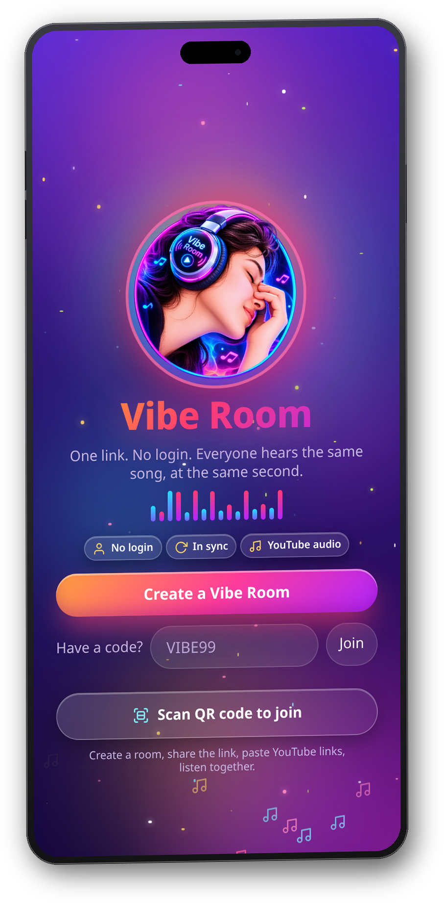
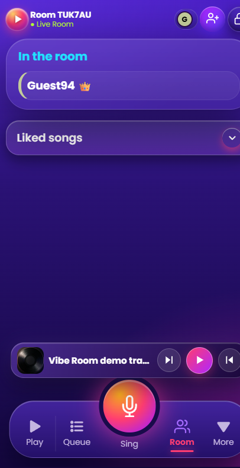

# Vibe Room

Listen to YouTube together in a synchronized room, or switch to karaoke and sing live with friends. Create a room, share its link, and join without creating an account.

## iPhone screenshots

Screenshots show the app in an iPhone-style portrait layout. The compact mini-player appears on the Queue, Sing, Room, and More tabs; it is intentionally hidden on Play. The demo track shown in those mini-player previews is screenshot-only.

| Home | Join a room |
| --- | --- |
|  |  |
| Play | Queue |
|  |  |
| Sing | Room |
|  |  |
| More | Room unavailable |
|  |  |

## Features

- **Shared listening:** room state and playback position are coordinated through a Node.js server and Socket.IO.
- **Room links and codes:** create a room, invite people with a link or QR code, or join with a short code. No account is required.
- **Host controls:** the host and co-hosts can control playback and the queue. The host can also grant or revoke playback control for individual guests.
- **Song requests:** guests can request YouTube tracks for host approval. Each guest can have up to 3 pending requests; a room can have up to 20. The host can close requests.
- **Queue safeguards:** the Queue tab shows the current song separately from upcoming tracks. Queue limit of 100 tracks, duplicate prevention, and a fair-add limit of 3 tracks among the next 10 per person.
- **Group skip:** guests can vote to skip a track; a majority can skip a track that cannot be played.
- **Karaoke:** request a singer, let the host assign the mic, and send processed microphone audio to the room over WebRTC.
- **Mobile controls:** the Play page has the full vinyl player; secondary tabs have a compact, icon-based mini-player when a track is loaded.
- **Room moderation:** host transfer, co-hosts, remove/ban controls, and automatic host succession after disconnect.

## Quick start

### Requirements

- Node.js 18 or newer
- npm

### Run locally

```sh
npm ci
npm start
```

Open [http://localhost:3000](http://localhost:3000). Create a room, then share its invite link or code.

The server listens on port `3000` by default. To use another port:

```powershell
$env:PORT = "3001"
npm start
```

```sh
PORT=3001 npm start
```

### Optional YouTube embed pre-check

To check a pasted link's public embed setting before it is added, enable the YouTube Data API v3 for a Google Cloud project and configure a server-side API key. Keep the key out of client code and source control.

PowerShell:

```powershell
$env:YOUTUBE_API_KEY = "your-server-side-key"
npm start
```

For Docker, pass the key through the server environment:

```powershell
docker run --rm -p 3000:3000 --env YOUTUBE_API_KEY=$env:YOUTUBE_API_KEY vibe-room
```

Without the key, Vibe Room still accepts links but cannot pre-check their embed status. A positive check only means YouTube marks the video as embeddable; playback may still depend on region, account, browser, or video availability.

### Run with Docker

```sh
docker build -t vibe-room .
docker run --rm -p 3000:3000 vibe-room
```

Then open [http://localhost:3000](http://localhost:3000).

## How to use

1. Select **Create a Vibe Room** on the home page.
2. Share the room link or invite code with friends.
3. Join the room, choose a display name and colour, then select **Join audio stream**.
4. Paste a YouTube link in the Queue tab. The host can start or pause playback.
5. Guests can request songs; the host approves or rejects requests.
6. Use **Invite** to share the room link or QR code. Use the bottom tabs to switch between Play, Queue, Sing, Room, and More.

If a room link is invalid or the room has expired, use **Create a new room** to get a fresh link, or **Back to home page** to enter another code.

## Karaoke

1. The host turns on **Karaoke** with the room-header button.
2. Open the **Sing** tab. Guests request to sing on a track; the host picks a singer.
3. The selected singer grants microphone access and taps **Start singing**.
4. Select a vocal effect or tune the custom reverb, EQ, and denoise controls.

Microphone access requires HTTPS, except on `localhost`, and the singer must grant browser permission. Headphones are recommended to prevent the backing track from leaking into the mic. WebRTC uses a public STUN server by default; some restrictive networks require a TURN server configured in `public/karaoke.js`.

**Record my vocals** records the processed microphone signal only; it does not record YouTube audio.

## Playback and room behavior

- The server is authoritative for the room clock and playback state. Clients use YouTube's embedded player and correct drift while playing.
- The volume slider and speaker buttons control local playback volume; the low-volume button mutes/restores the previous level, and the high-volume button sets it to 100%.
- Host and co-host controls are available by default. The host may grant control to a guest. Other guests can request tracks and vote to skip.
- If the host leaves explicitly, host duties transfer immediately; after an unexpected disconnect, succession waits 30 seconds.
- Rooms are held in memory and are not persisted to a database. They are removed 24 hours after becoming empty.
- A single server instance is expected. Multi-instance deployment needs shared room state and a Socket.IO adapter.
- Deploy on a host that supports long-lived Node.js processes and WebSockets. A serverless-only host such as Vercel Functions cannot run this Socket.IO server by itself.

## Project layout

```text
server.js                 Express and Socket.IO room server
package.json              Scripts, runtime requirement, and dependencies
package-lock.json         Locked npm dependency versions
.gitignore                Local dependencies and secrets excluded from Git
public/
  index.html              Home, join, and room interface
  app.js                  Room state, player sync, and controls
  extras.js               Mini-player and additional controls
  karaoke.js              Karaoke effects and WebRTC
  starmaker.js            Tab navigation and visual enhancements
  style.css               Responsive glassmorphic UI
docs/screenshots/         iPhone page screenshots for this README
```

## Troubleshooting

- **Room unavailable:** check the code/link. Rooms are temporary and disappear after being empty for 24 hours; create a new room if it has expired.
- **A YouTube link will not play:** check the Queue tab's embed-status message. Configure `YOUTUBE_API_KEY` for pre-checks; YouTube may still restrict a video by region, account, or availability.
- **No microphone access:** use HTTPS (or `localhost`) and allow microphone permission in the browser.
- **Karaoke audio does not reach someone:** restrictive NAT or firewall settings may require a TURN server.

## Not included

There is no built-in YouTube search, text chat, Auto-DJ, persistent database, or Auto-Tune pitch correction.
