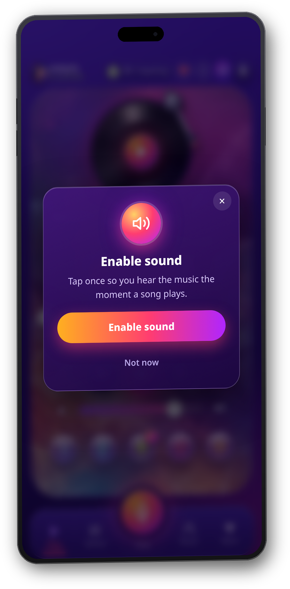
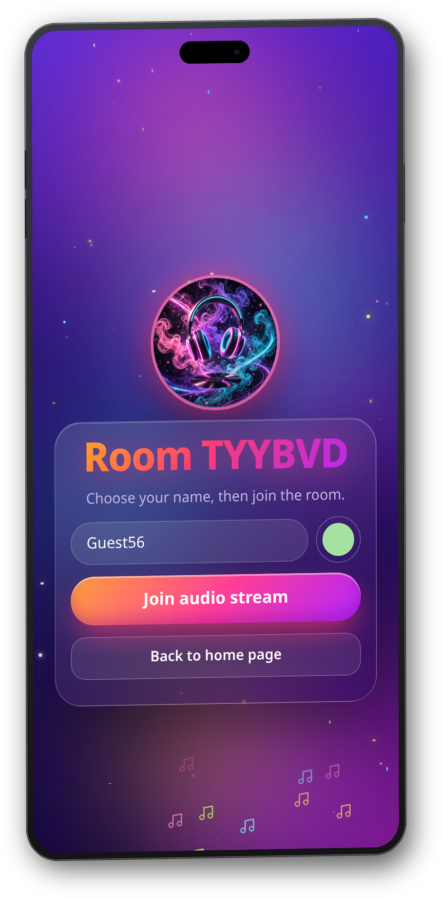
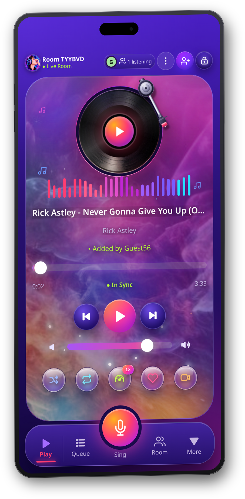
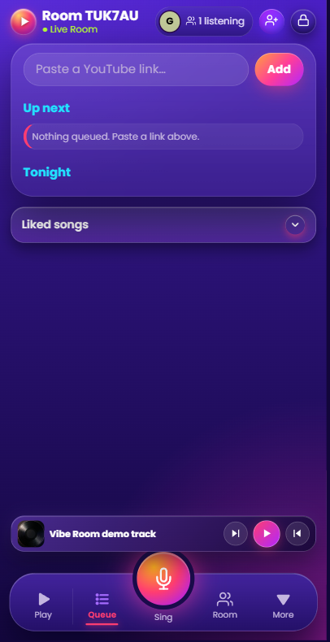
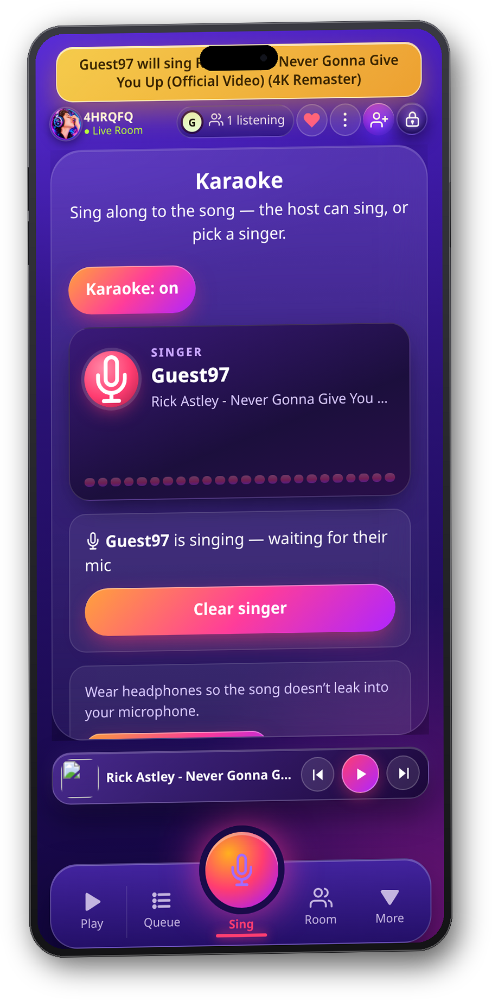
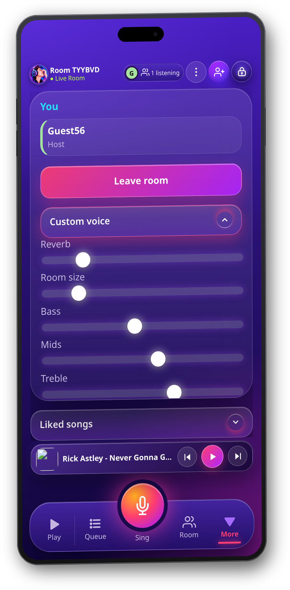
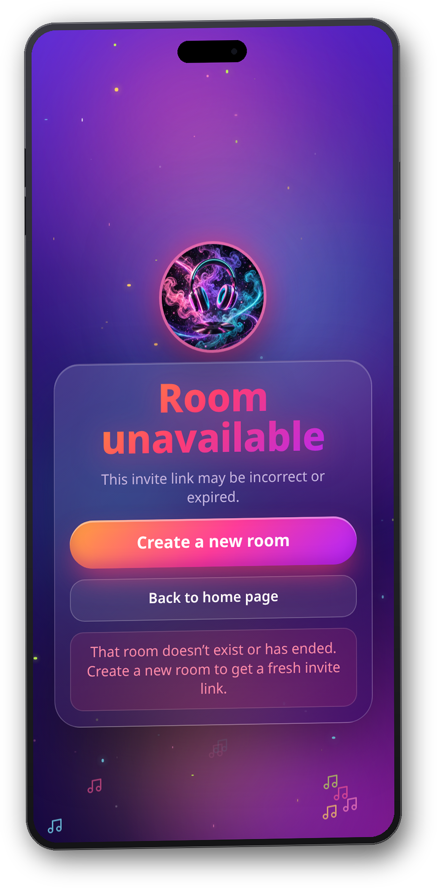

# Vibe Room

> Listen to YouTube together, in perfect sync — or switch to karaoke and sing live with your friends. No account, no install, no friction.

[](https://nodejs.org/)
[](https://socket.io/)
[](https://developers.google.com/youtube/iframe_api_reference)
[](https://web.dev/progressive-web-apps/)
[](LICENSE)

---

## 🚀 Try it live

**Open a live room right now — no sign-up, no download:**

### 👉 [Join the live room — vibe-room-0isd.onrender.com/room/7AG9RD](https://vibe-room-0isd.onrender.com/room/7AG9RD)

Prefer to start fresh? Open the app and create your own room:

### 👉 [vibe-room-0isd.onrender.com](https://vibe-room-0isd.onrender.com/)

> **Note:** Rooms are temporary by design — a room disappears 24 hours after it becomes empty. If the room above has expired, just open the app link and tap **Create a Vibe Room** to get a fresh one.

---

## 📱 Android app — download the APK

**On Android? Get the app directly — no Play Store needed:**

### 👉 [Download VibeRoom.apk](https://vibe-room-0isd.onrender.com/VibeRoom.apk)

Tap the link on your Android phone, then tap the downloaded file to install. Your phone may ask you to allow installs from this source — that is normal for a direct download. The app plays music in the background (it keeps playing after the screen locks, and the lock-screen play/pause buttons control the room), has mic, audio, storage and Bluetooth access, shows the Vibe Room logo as its icon, and checks for updates itself — it offers a new version whenever one is released.

---

## What is Vibe Room?

Vibe Room is a shared listening room for YouTube. One person hosts, everyone listens to the same song at the same time, and anyone can join from a link — no account, no app install, no extra steps.

- **Create a room** and share its link, QR code, or 6-character code.
- **Paste a YouTube link** and the whole room hears it — audio only, in sync.
- **Scan a room QR code** — the home page has a **Scan QR code to join** button that opens your camera; point it at a room's QR code and you join instantly.
- **Hand over control** — the host can give playback control to any guest.
- **Switch to karaoke** — the host picks a singer and their live voice streams to everyone, over the music.
- **Free, supported by ads** — a small ad card appears only inside a joined room, after 5 seconds of no activity, and a bigger ad board over the middle of the player on the Play tab; closing one closes both. Ads never show on the landing page and never cover the player controls.

It runs as a web app on any phone or computer, and it can be added to a phone's home screen like a native app.

---

## ✨ Key features

### Shared listening
- **Synchronised playback** — the server owns the room clock; every device corrects drift while playing, so the room stays in sync.
- **No login** — join from a link, QR code, or room code with just a display name and a colour.
- **Instant sound** — the moment you create or join a room, a small popup asks for sound; one tap and the music plays. It asks once per device, then never again on that device.
- **Background audio** — music keeps playing when you leave the app or lock the screen. If it stops when you lock the screen, press play on the lock screen — the audio keeps playing. Uploaded audio files keep playing automatically, with no button needed.
- **10-second skip** — compact forward/back 10s buttons sit outside prev/next in the player.
- **Scrolling song title** — a long song name slowly scrolls across the player card in the premium Sora typeface, instead of being cut off.
- **Swipe to dismiss** — any notification can be swiped up to dismiss it.

### Queue & requests
- **Paste any YouTube link** — the Queue tab has the paste box; the Play page's empty state has a compact **Add a YouTube link** button that jumps straight there.
- **Upload an audio file** — pick an MP3, M4A, WAV, or OGG from your device (up to 25 MB); it plays for everyone in sync, and unlike YouTube songs it keeps playing in the background on lock screen and app-switch.
- **Your playlist** — every link you paste is saved on your device; tap any past song to queue it again.
- **Song requests** — guests request tracks for host approval (up to 3 pending per guest, 20 per room); the host can open or close requests.
- **Queue safeguards** — 100-track cap, duplicate prevention, and a fair-add limit of 3 tracks among the next 10 per person.
- **Smart skipping** — only the host, co-hosts, and authorised controllers can skip. A track auto-skips only when a strict majority of listeners report a playback error.

### Host controls & moderation
- **Host transfer & co-hosts** — if the host leaves, duties pass immediately; after an unexpected disconnect, succession waits 12 seconds.
- **Request notifications** — when a guest requests a song or asks to sing, the host gets a yellow toast notification.
- **Grant / revoke control** — the host can give playback control to any guest, and take it back.
- **Remove / ban** — the host can remove or ban participants.
- **Embed pre-check** — with a YouTube Data API key configured, a pasted link is checked for embed restrictions before it is added.

### Karaoke
- **Live voice** — the host assigns the mic; the singer's processed voice streams to every participant over WebRTC, in real time with the music.
- **11 voice effects** plus custom reverb, EQ, and denoise controls — and a **Hear myself** monitor.
- **Sound mix** — separate Music and Voice sliders in the Sing tab; Voice controls your own monitor if you are singing, or the singer's voice if you are listening. Both are remembered on your device.
- **Record my vocals** — saves the processed microphone signal (YouTube audio is never recorded).

### Experience
- **Cosmic smoke player** — the player card has a living neon smoke background (purple, magenta, cyan, orange) that jumps and drifts randomly on the song's beat while a song plays and calms when it pauses. It is a playback-driven beat simulation — the page cannot read YouTube audio directly.
- **Liked songs** — a heart icon in the header opens a slide-in panel with every song you liked, saved forever on your device. Add any of them to the queue or request it.
- **History** — a three-dots menu in the header shows the songs you played, saved on your device. Every old song can be copied or added back to the queue. Reloading the page rejoins your room and keeps all history.
- **iPhone-ready** — the layout auto-detects the notch and Dynamic Island (iPhone 13–18) and the home-indicator bar and adjusts every element automatically, so nothing is ever hidden. Tapping a text field never zooms the page.
- **Header that fits everyone** — the full 6-letter room code is always visible on the left, and every top button sits on the right, however many people join.
- **Bottom navigation** — docked at the very bottom of the screen, with all four corners the same radius, following your device's own bottom screen shape.
- **Cool mode** — a switch in the More tab turns the page flat and dark, stops the floating orbs and rising notes as well as the disc and smoke, and lets the screen sleep, so the phone stays cool while music plays; the phone already stays cool in normal use too, because every animation runs on cheap transforms only (no blur on any moving layer) and the glass blur is kept light; leave it untouched for 30 seconds and the animations freeze instead (same colours, nothing moving) until you tap.
- **Installable (PWA)** — add it to your home screen from Safari or Chrome for a full-screen app experience.
- **Android app** — a native APK wrapper loads the live site, with background audio that keeps playing after the screen locks (the lock-screen play/pause buttons control the room), a flicker-free interface (buttons, cards and notifications stay steady while music plays), mic/files/Bluetooth permissions, the Vibe Room logo as its icon, and a self-update check that offers a new version whenever one is released.
- **Share card & favicon** — sharing the room link shows a proper preview card (the neon emblem, the name, and the tagline) on WhatsApp, iMessage, X, and Facebook, and the browser tab shows the emblem as its icon.
- **Mini-player** — a compact player bar follows you across the Queue, Sing, Room, and More tabs.
- **Media Session** — lock-screen play, pause, skip, previous, and seek on supported browsers.

---

## 📱 Screenshots

Every screen below is a fresh screenshot of the app running in a 3D iPhone frame. The compact mini-player appears on the Queue, Sing, Room, and More tabs; it is intentionally hidden on Play.

<p align="center"></p>
<p align="center"><em>The moment you create or join a room, a small premium popup asks for sound — one tap and the music plays.</em></p>

| Home | Join a room |
| --- | --- |
|  |  |
| Play | Queue |
|  |  |
| Sing | Room |
|  |  |
| More | Room unavailable |
|  |  |

---

## 🧭 How to use

1. **Create a room** — tap **Create a Vibe Room** on the home page.
2. **Invite friends** — share the room link, QR code, or 6-character code.
3. **Join** — pick a display name and colour, then tap **Join audio stream**. Or tap **Scan QR code to join** on the home page and point your camera at a room's QR code. When the sound popup appears, tap **Enable sound**.
4. **Add music** — go to the **Queue** tab and paste a YouTube link (or tap **Add a YouTube link** on the empty Play page). The host starts or pauses playback.
5. **Request songs** — guests paste a link to request it; the host approves or rejects.
6. **Switch tabs** — use the bottom bar for **Play**, **Queue**, **Sing**, **Room**, and **More**. Tap **Invite** any time to share the room again.

If a room link is invalid or the room has expired, tap **Create a new room** for a fresh link, or **Back to home page** to enter another code.

---

## 🎤 Karaoke

1. The host turns on **Karaoke** with the room-header button.
2. Open the **Sing** tab. The host can sing directly, or guests request to sing and the host picks a singer.
3. The selected singer grants microphone access and taps **Start singing**.
4. Choose a vocal effect, or tune the custom reverb, EQ, and denoise controls. Tick **Hear myself** to monitor your own voice.

Microphone access requires HTTPS (except on `localhost`), and the singer must grant browser permission. Headphones are recommended so the backing track does not leak into the mic. The singer's voice starts with the **Start singing** tap, so the browser allows the microphone audio to flow; it then reaches every participant, including the host, and the singer hears themselves when **Hear myself** is ticked. WebRTC uses a public STUN server by default; some restrictive networks need a TURN server configured in `public/karaoke.js`.

**Record my vocals** records the processed microphone signal only; it does not record YouTube audio.

---

## 🛠 Tech stack

| Layer | Technology |
| --- | --- |
| Server | Node.js + Express |
| Realtime | Socket.IO (WebSockets) |
| Playback | YouTube IFrame Player API |
| Karaoke voice | WebRTC + Web Audio API |
| Client | Vanilla HTML / CSS / JavaScript (no framework) |
| Installable | Progressive Web App (manifest + service worker) |
| Deployment | Docker-ready; runs on any host with long-lived Node.js processes |

---

## ⚡ Quick start

### Requirements

- Node.js 18 or newer
- npm

### Run locally

```sh
npm ci
npm start
```

Open [http://localhost:3000](http://localhost:3000). Create a room, then share its invite link or code.

The server listens on port `3000` by default. To use another port:

```powershell
$env:PORT = "3001"
npm start
```

```sh
PORT=3001 npm start
```

### Run with Docker

```sh
docker build -t vibe-room .
docker run --rm -p 3000:3000 vibe-room
```

Then open [http://localhost:3000](http://localhost:3000).

### Optional: YouTube embed pre-check

To check a pasted link's public embed setting before it is added, enable the YouTube Data API v3 for a Google Cloud project and configure a server-side API key. Keep the key out of client code and source control.

PowerShell:

```powershell
$env:YOUTUBE_API_KEY = "your-server-side-key"
npm start
```

For Docker, pass the key through the server environment:

```powershell
docker run --rm -p 3000:3000 --env YOUTUBE_API_KEY=$env:YOUTUBE_API_KEY vibe-room
```

Without the key, Vibe Room still accepts links but cannot pre-check their embed status. A positive check only means YouTube marks the video as embeddable; playback may still depend on region, account, browser, or video availability.

---

## 📐 Playback & room behaviour

- **Authoritative clock** — the server owns the room clock and playback state. Clients use YouTube's embedded player and correct drift while playing.
- **Volume** — the slider and speaker buttons control local playback volume; the low-volume button mutes/restores the previous level, and the high-volume button sets it to 100%.
- **Permissions** — host and co-host controls are available by default. The host may grant control to a guest. Other guests can request tracks; the host must approve a request before it enters the queue.
- **Media Session** — on supporting browsers, Vibe Room publishes track metadata and lock-screen play, pause, skip, previous, and seek actions. Returning from a suspended page triggers a room reconnect and state resync.
- **Background playback** — when you leave the app or lock the screen, the app asks the player to keep going and refreshes the lock-screen controls, and keeps retrying the resume for as long as the page stays hidden, so the song keeps playing even if the system pauses it a moment after you leave. The Android app (v1.4+) also owns a native media session, so the music keeps playing after the screen locks and the lock-screen play/pause buttons control the room. If the system does pause it, the music restarts the instant you return — no tap needed. It cannot survive the app being swiped away or force-closed, or the system reclaiming it.
- **Host succession** — if the host leaves explicitly, host duties transfer immediately; after an unexpected disconnect, succession waits 12 seconds.
- **Room lifetime** — rooms are held in memory and are not persisted to a database. They are removed 24 hours after becoming empty.
- **Scaling** — a single server instance is expected. Multi-instance deployment needs shared room state and a Socket.IO adapter.
- **Hosting** — deploy on a host that supports long-lived Node.js processes and WebSockets. A serverless-only host such as Vercel Functions cannot run this Socket.IO server by itself.

---

## 📁 Project layout

```text
server.js                 Express and Socket.IO room server
package.json              Scripts, runtime requirement, and dependencies
package-lock.json         Locked npm dependency versions
.gitignore                Local dependencies and secrets excluded from Git
public/
  index.html              Home, join, and room interface
  app.js                  Room state, player sync, and controls
  extras.js               Mini-player and additional controls
  karaoke.js              Karaoke effects and WebRTC
  starmaker.js            Tab navigation and visual enhancements
  style.css               Responsive glassmorphic UI
  smoke.jpg               Cosmic smoke texture for the player card
  logo.png                Vibe Room emblem (header, landing, PWA icons)
  og-hero.png             Share-preview hero image (1200×630) for link cards
  favicon.ico             Browser-tab icon (16/32/48) from the emblem
  favicon-32.png          Browser-tab icon (32×32) for modern browsers
  jsqr.min.js             QR-code reader for the Scan-to-join camera
docs/screenshots/         iPhone page screenshots for this README
```

---

## ❓ Troubleshooting

| Problem | What to try |
| --- | --- |
| **Room unavailable** | Check the code/link. Rooms are temporary and disappear after being empty for 24 hours; create a new room if it has expired. |
| **A YouTube link will not play** | Check the Queue tab's embed-status message. Configure `YOUTUBE_API_KEY` for pre-checks; YouTube may still restrict a video by region, account, or availability. |
| **No sound after joining** | Tap **Enable sound** in the popup, or tap anywhere on the page once. Check the tab is not muted and the device volume is up. |
| **No microphone access** | Use HTTPS (or `localhost`) and allow microphone permission in the browser. |
| **Karaoke audio does not reach someone** | Make sure the singer tapped **Start singing** (the voice starts on that tap) and allowed microphone permission. The stage shows a voice status line — green means the voice is connected. Restrictive NAT or firewall settings may still require a TURN server. |

---

## 🔒 Privacy

- **No accounts, no tracking.** A room is joined with a display name and a colour; nothing is stored on a server beyond the live room state.
- **History stays on your device.** The rooms you visited and the songs you played are saved in your browser's local storage, never sent to a server.
- **Your API key stays server-side.** The YouTube Data API key (if used) lives only in the server environment.

---

## 📝 Not included

There is no built-in YouTube search, text chat, Auto-DJ, persistent database, or Auto-Tune pitch correction.

---

<p align="center"><b>Vibe Room</b> — listen together, sing together.</p>
